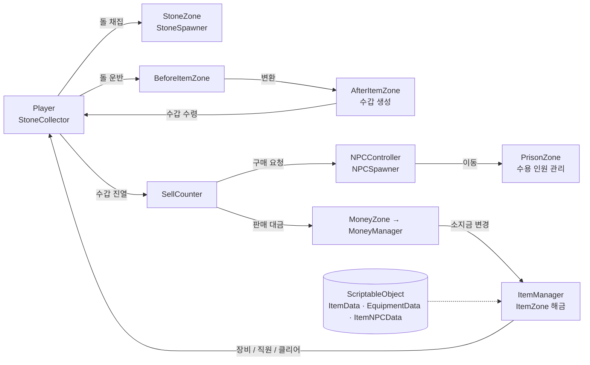

# 🔒 *PrisonLife - Unity 하이퍼캐주얼 시뮬레이션*
Unity(C#)로 제작한 하이퍼캐주얼 시뮬레이션 게임입니다.
돌을 캐서 수갑을 만들고, NPC에게 판매한 돈으로 장비와 직원을 해금하며 감옥을 채워 나가는 게임 루프를 처음부터 끝까지(클리어까지) 구현했습니다.
<br />

> **Unity 2022.3.62f2 (LTS)** · C# · 모바일 조이스틱 조작 · 작업 기간: 2026.05

<br />

***

### ✅ 게임 루프

`돌 채집` → `수갑 제작` → `판매대에 수갑 진열` → `NPC 구매` → `돈 획득` → `구역 해금(장비 / 직원 / 클리어)` → `감옥 수용 인원 가득 → Clear`

<br />

***

### ✅ 주요 기능

- **장비 충돌 감지 기반 돌 채집 시스템**
    - 장비(Equipment)의 `OverlapBox` 범위로 돌을 감지해 수집하고, 소지 한도(MAX)를 넘으면 안내 UI를 표시
    - 수집한 돌은 플레이어 등 뒤에 쌓이고, 수집된 자리는 일정 시간 뒤 리스폰

      <br />
- **구역(Zone) 기반 아이템 가공 · 판매 파이프라인**
    - `BeforeItemZone`에 돌을 내려놓으면 `AfterItemZone`에서 수갑으로 변환되고, `SellCounter`에 올리면 NPC가 구매
    - 스택 연출은 코루틴으로 하나씩 순차 이동하도록 구현

      <br />
- **상태 머신 기반 NPC AI**
    - 손님 NPC: `Waiting → Moving → Arrived / NoCell` 상태 전이, 웨이포인트(`WaypointPath`) 따라 감옥으로 이동
    - 직원 NPC: `MoveToStoneZone → FindingStone → ChasingStone` 상태로 가장 가까운 돌을 탐색·추적해 `BeforeItemZone`으로 운반
    - 손님마다 랜덤 구매 수량(1~5개)을 말풍선(World Space UI)으로 표시

      <br />
- **감옥 수용 인원 예약 시스템**
    - 구매 직전 `TryReserve()`로 자리를 먼저 예약하고, 도착 시 입장 / 실패 시 `CancelReserve()`로 취소
    - 수용 인원(20명)이 가득 차면 대기 중인 모든 NPC에 `No Cell`을 표시하고 클리어 구역을 활성화

      <br />
- **ScriptableObject 기반 데이터 주도 해금 시스템**
    - `ItemData`, `EquipmentData`, `ItemNPCData`를 ScriptableObject로 분리해 가격·아이콘·장비 크기·NPC 프리팹을 에셋으로 관리
    - 소지금 변화(`MoneyManager`)가 `ItemManager`에 전달되면 구매 가능한 구역만 활성화되는 이벤트성 흐름
    - 해금 종류: **장비 교체 / 직원 NPC 고용(채굴·판매) / 클리어**

      <br />
- **모바일 지향 조작 및 UI**
    - Joystick Pack 기반 이동, `CharacterController` + `Animator` 연동, 카메라 팔로우
    - 가격·수용량·말풍선 UI를 카메라를 바라보는 빌보드 방식으로 구현

<br />

***

### ✅ 구조도



<br />

***

### ✅ 구현 영상

<br />

<p align="center">

</p>

<br />

***

### ✅ Tech Stack

| 분류 | 기술 |
|---|---|
| Language | C# |
| Engine | Unity 2022.3.62f2 |
| UI | TextMeshPro, World Space Canvas, Joystick Pack |
| Navigation / Movement | CharacterController, NavMesh, Waypoint 이동 |
| Data | ScriptableObject |

<br />

***

### ✅ 프로젝트 구조

```
Assets/PrisonLife
├── Camera      # 카메라 팔로우
├── Character
│   ├── Player  # 이동(PrisonCatController), 채집·적재(StoneCollector)
│   └── NPC     # 손님 NPC 컨트롤러 / 스포너 / 웨이포인트
├── Item
│   ├── Equip   # 장비 데이터·장착·충돌 감지
│   ├── Stone   # 돌 스포너
│   ├── Money   # 소지금 관리
│   └── ItemNPC # 직원 NPC (돌 채굴 / 판매)
├── Zone        # Before/After ItemZone, SellCounter, MoneyZone, PrisonZone
├── UI
└── GameManager.cs
```

<br />
